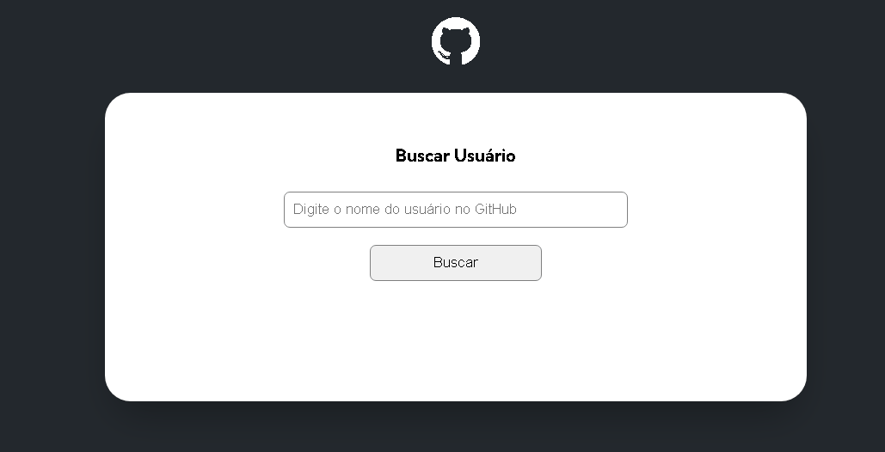

# Busca de perfis do GitHub

Aplicação web que consome a API pública do GitHub e mostra o perfil de qualquer usuário: foto, nome, bio, seguidores, repositórios e atividade recente.

**Online:** https://ygos-96.github.io/api-github/

Foi o projeto final do módulo avançado de JavaScript do curso Dev Quest, e é o meu primeiro contato com `fetch`, `async/await` e organização de código em módulos.



## O que faz

- Busca por nome de usuário, com o botão **Buscar** ou com a tecla **Enter**.
- Valida o campo vazio antes de chamar a API.
- Mostra foto, nome, bio, seguidores e quantos perfis o usuário segue.
- Lista os 10 primeiros repositórios, com forks, estrelas, observadores e linguagem, cada um com link para o GitHub.
- Mostra a atividade recente: as mensagens de commit dos últimos eventos públicos, agrupadas por repositório.
- Trata o caso de usuário inexistente e de campos vazios no perfil (sem nome ou sem bio) com mensagens amigáveis.

## Como está organizado

```
src/scripts/
  index.js            eventos da tela e fluxo principal
  variables.js        URL base da API e quantidade de itens
  services/           chamadas à API (user, repositories, events)
  objects/            estado do usuário (user.js) e renderização (screen.js)
src/css/              reset e estilos
```

A separação em `services` (rede), `objects` (dados) e `screen` (interface) mantém cada arquivo com uma única responsabilidade.

## Tecnologias

HTML5, CSS3 e JavaScript puro (módulos ES), consumindo a [API REST do GitHub](https://docs.github.com/rest) sem autenticação.

## Rodar localmente

Por usar módulos ES, precisa ser servido por HTTP (não abre direto pelo arquivo):

```bash
npx serve .
```

## Limitações conhecidas

- Sem autenticação, a API do GitHub limita as requisições por hora e por IP. Se o limite estourar, a busca deixa de responder até a janela renovar.
- A renderização monta HTML com `innerHTML` a partir de dados da API. Para um projeto de estudo é aceitável, mas em produção esses campos deveriam ser tratados com `textContent` ou escapados para evitar XSS. É o tipo de ponto que hoje eu revisaria primeiro.
